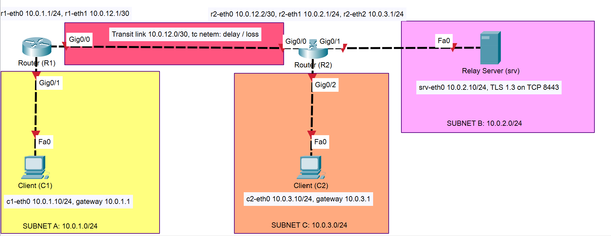
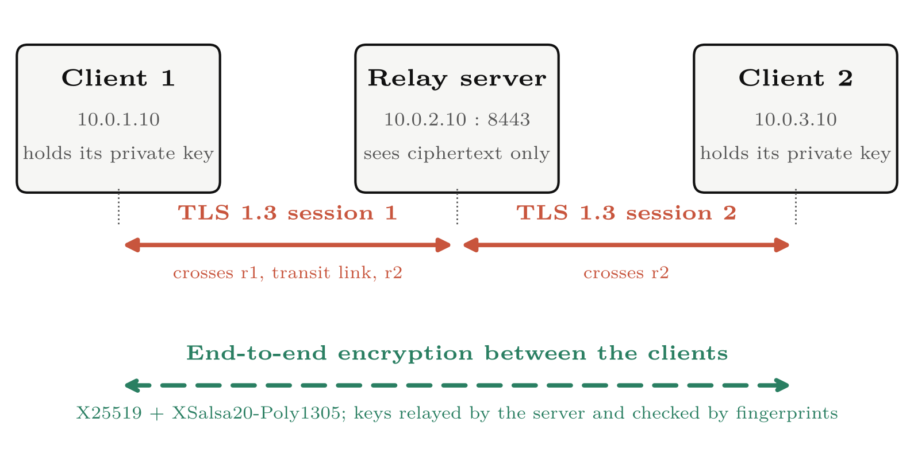
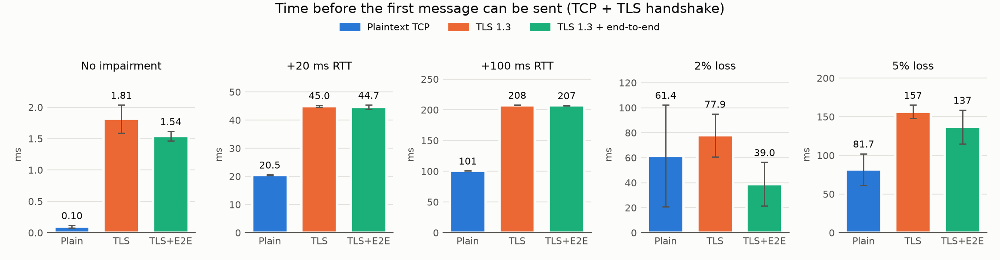
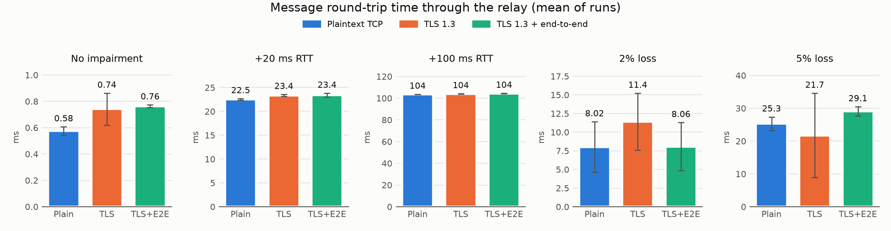
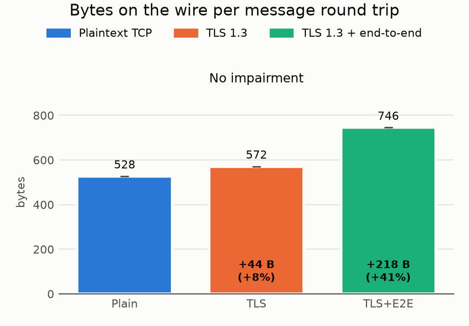

# Secure Messaging over TLS 1.3 with End-to-End Encryption

A messaging system in which two clients talk through a relay server across a routed network, with two independent layers of protection:

1. **TLS 1.3** secures every hop between a client and the server against anyone on the network path.
2. **End-to-end encryption** (PyNaCl / libsodium) secures each message between the two clients, so even the relay server only ever handles ciphertext it cannot read.

The system runs on a real routed topology of two routers and three subnets built with Linux network namespaces. Packet captures show what each layer protects, and an automated experiment suite measures the cost of each layer under controlled delay and packet loss.

Course project for **CS3001 Computer Networks**, FAST School of Computing, FAST-NUCES Karachi, Fall 2026.

---

## Contents

- [Architecture](#architecture)
- [How it works](#how-it-works)
- [Repository layout](#repository-layout)
- [Requirements](#requirements)
- [Quick start](#quick-start)
- [Security modes](#security-modes)
- [Packet captures](#packet-captures)
- [Experiments](#experiments)
- [Results](#results)
- [Troubleshooting](#troubleshooting)
- [Limitations and future work](#limitations-and-future-work)
- [AI-use disclosure](#ai-use-disclosure)

---

## Architecture





### Addressing plan

| Network | CIDR | Interfaces |
|---|---|---|
| Subnet A (Client 1) | 10.0.1.0/24 | c1-eth0 = 10.0.1.10, r1-eth0 = 10.0.1.1 |
| Transit link (R1 to R2) | 10.0.12.0/30 | r1-eth1 = 10.0.12.1, r2-eth0 = 10.0.12.2 |
| Subnet B (Relay server) | 10.0.2.0/24 | srv-eth0 = 10.0.2.10, r2-eth1 = 10.0.2.1 |
| Subnet C (Client 2) | 10.0.3.0/24 | c2-eth0 = 10.0.3.10, r2-eth2 = 10.0.3.1 |

### Ports and protocols

| Service | Address and port | Protocol |
|---|---|---|
| Relay server | 10.0.2.10, TCP 8443 | TLS 1.3 (or plaintext TCP in baseline mode) |
| Routing | r1 and r2 | Static IPv4 routes, IP forwarding enabled |
| Impairment | r1-eth1 and r2-eth0 | tc netem (delay and loss) on the transit link |

### Routing

| Device | Routes |
|---|---|
| c1 | default via 10.0.1.1 |
| r1 | 10.0.2.0/24 and 10.0.3.0/24 via 10.0.12.2 |
| r2 | 10.0.1.0/24 via 10.0.12.1 |
| srv | default via 10.0.2.1 |
| c2 | default via 10.0.3.1 |

Traffic from Client 1 to the server crosses both routers and the transit link. A traceroute from Client 1 to Client 2 shows the three hops 10.0.1.1, 10.0.12.2 and 10.0.3.10 (see [`docs/topology_status.txt`](docs/topology_status.txt)).

---

## How it works

### Message framing

TCP is a byte stream with no message boundaries, so every message is sent as a frame: a 4-byte big-endian length followed by a UTF-8 JSON object. Frames larger than 64 KiB are rejected. See [`src/protocol.py`](src/protocol.py).

| Direction | Message types |
|---|---|
| Client to server | `hello` (name and public key), `send` (recipient and body) |
| Server to client | `welcome` (online peers and their public keys), `peer_joined`, `peer_left`, `deliver`, `error` |

The server reads only the routing fields (`type`, `name`, `to`) and copies the `body` to the recipient unchanged.

### Layer 1: TLS 1.3

- Both sides accept **TLS 1.3 only** (RFC 8446). Older versions are refused.
- The server presents a self-signed **ECDSA P-256** certificate valid for 10.0.2.10.
- Clients trust only that exact certificate (certificate pinning) with hostname checking enabled, so a man-in-the-middle presenting any other certificate is rejected.
- The negotiated cipher suite is `TLS_AES_256_GCM_SHA384`.

See [`src/tls_config.py`](src/tls_config.py).

### Layer 2: End-to-end encryption

- Each client creates a fresh **X25519** key pair at start-up. The public key travels in the `hello` message; the private key never leaves the client.
- Messages are sealed with NaCl `crypto_box` (X25519 key agreement, XSalsa20 stream cipher, Poly1305 authenticator) using the sender's private key and the recipient's public key.
- Every message uses a new random 24-byte nonce and carries a 16-byte authentication tag, so it grows by **40 bytes** before Base64 encoding. A message that was altered fails authentication and is rejected.
- Because the server distributes public keys, a malicious server could substitute its own. Each client therefore shows short **key fingerprints** (`/keys`) that two users can compare over another channel, the same idea as Signal safety numbers.

See [`src/crypto_e2e.py`](src/crypto_e2e.py).

---

## Repository layout

```
secure-messaging-tls13-e2ee/
├── topology/
│   ├── setup.sh              builds the namespaces, links, addresses and routes, then self-tests
│   ├── teardown.sh           removes the topology
│   ├── status.sh             prints addresses, routing tables and a traceroute
│   └── netem.sh              applies or clears delay and loss on the transit link
├── src/
│   ├── protocol.py           length-prefixed JSON framing and message types
│   ├── tls_config.py         TLS 1.3 server and client contexts, key logging for captures
│   ├── crypto_e2e.py         end-to-end encryption and key fingerprints
│   ├── server.py             relay server
│   ├── client.py             interactive chat client
│   ├── echo_bot.py           automatic responder used by the experiments
│   └── bench_client.py       measurement client used by the experiments
├── scripts/
│   ├── generate_cert.sh      creates the server certificate and private key
│   ├── run_in_ns.sh          runs a program inside a namespace as the normal user
│   ├── capture.sh            records a pcapng capture, plus a copy with embedded TLS secrets
│   └── inspect_capture.py    prints the protocol messages found inside a capture
├── experiments/
│   ├── run_experiments.py    runs every condition, mode and repetition automatically
│   ├── plot_results.py       draws the figures
│   ├── results/              raw_runs.csv, summary.csv, summary.md, environment.txt
│   └── plots/                connection_setup.png, message_rtt.png, wire_bytes.png
├── captures/                 pcapng evidence for each protocol exchange
├── docs/                     architecture diagram, topology status, capture inspections
└── requirements.txt
```

---

## Requirements

- Linux with network namespaces and the `sch_netem` kernel module. Tested on **Ubuntu 24.04 under WSL 2** on Windows 11.
- Root access (`sudo`) for namespaces, traffic control and packet capture.
- System packages:

```bash
sudo apt update
sudo apt install -y python3-venv python3-pip iproute2 iputils-ping traceroute tcpdump tshark openssl
```

- Python packages (PyNaCl, and matplotlib for the figures):

```bash
python3 -m venv .venv
source .venv/bin/activate
pip install -r requirements.txt
```

---

## Quick start

All commands run from the repository root.

**1. Build the network and create the server certificate**

```bash
sudo ./topology/setup.sh
./scripts/generate_cert.sh
```

`setup.sh` finishes by pinging every important path and prints `PASS` for each one.

**2. Start the relay server** (terminal 1)

```bash
sudo ./scripts/run_in_ns.sh srv .venv/bin/python src/server.py
```

**3. Start the two clients** (terminals 2 and 3)

```bash
sudo ./scripts/run_in_ns.sh c1 .venv/bin/python src/client.py --name client1
sudo ./scripts/run_in_ns.sh c2 .venv/bin/python src/client.py --name client2
```

Type a message and press Enter. Client commands: `/peers`, `/keys`, `/quit`.

The server log shows each relayed message as the server sees it. With end-to-end encryption on, the body is ciphertext:

```
Relayed client1 -> client2 | 80 bytes | encrypted=True | body as seen by server: 'E1hBupHN6ff/osRA7D8Tw1/o...'
```

**4. Inspect or remove the topology**

```bash
sudo ./topology/status.sh
sudo ./topology/teardown.sh
```

---

## Security modes

| Mode | Server flags | Client flags | Who can read message bodies |
|---|---|---|---|
| Plaintext | `--plain` | `--plain --no-e2e` | anyone on the network path |
| TLS 1.3 only | (none) | `--no-e2e` | the relay server |
| TLS 1.3 + end-to-end | (none) | (none) | only the two clients |

---

## Packet captures

The `captures/` folder holds evidence for each key protocol exchange. Files ending in `_with_keys.pcapng` contain the TLS session secrets of that short demonstration session, so Wireshark opens them with the TLS layer already decrypted.

| File | What it shows |
|---|---|
| `tls13_e2e_session.pcapng` | TCP three-way handshake, TLS 1.3 handshake (1-RTT), encrypted records |
| `tls13_e2e_session_with_keys.pcapng` | the same session with TLS removed: message bodies are still end-to-end ciphertext |
| `tls_only.pcapng`, `tls_only_with_keys.pcapng` | TLS without end-to-end encryption: readable once TLS is removed |
| `plaintext_baseline.pcapng` | no protection: message text readable directly on the wire |
| `traceroute_transit.pcapng` | traceroute probes and ICMP replies crossing the transit link |

Print the protocol messages inside any capture:

```bash
python3 scripts/inspect_capture.py captures/tls13_e2e_session_with_keys.pcapng
```

| Capture | Message body seen after removing TLS |
|---|---|
| Plaintext | `'HI C2'` (no TLS to remove) |
| TLS only | `'Hello c1'` |
| TLS + end-to-end | `'E1hBupHN6ff/osRA7D8Tw1/o...'` |

To record a new capture (terminal 4, start it before the clients):

```bash
rm -f captures/sslkeys.log
sudo SSLKEYLOGFILE=captures/sslkeys.log ./scripts/run_in_ns.sh srv .venv/bin/python src/server.py
sudo ./scripts/capture.sh my_session
```

Press Ctrl+C in the capture terminal to stop.

---

## Experiments

`experiments/run_experiments.py` runs the whole evaluation unattended. For each run it starts the server, an echo bot in Client 2 and a measurement client in Client 1, then stops them again.

**Network conditions** (applied to both directions of the transit link with `tc netem`)

| Name | Impairment |
|---|---|
| `baseline` | none |
| `rtt_20` | +20 ms round-trip time |
| `rtt_100` | +100 ms round-trip time |
| `loss_2` | 2% packet loss |
| `loss_5` | 5% packet loss |

**Metrics**

| Metric | How it is measured |
|---|---|
| TCP connection setup | time for `connect()` to return (the three-way handshake) |
| TLS 1.3 handshake | time for the TLS handshake on top of the open TCP connection |
| Message round-trip time | Client 1 to server to Client 2 (echo) to server to Client 1, timed in one process |
| Bytes on the wire per message | kernel byte counters of `c1-eth0`, before and after the message phase |

Every condition and security mode is run **3 times**. Each run opens 50 connections and sends 100 messages. The summary reports the mean of the run means and the standard deviation across runs.

```bash
sudo ./topology/setup.sh
sudo .venv/bin/python experiments/run_experiments.py --handshakes 50 --messages 100
.venv/bin/python experiments/plot_results.py
```

The full run takes about 10 minutes. Results are written to `experiments/results/`, and the machine details used are recorded in `environment.txt`.

---

## Results

Full tables: [`experiments/results/summary.md`](experiments/results/summary.md)







### Time before the first message can be sent (ms, mean of 3 runs)

| Condition | Plaintext | TLS 1.3 | TLS 1.3 + E2E |
|---|---|---|---|
| No impairment | 0.10 | 1.81 | 1.54 |
| +20 ms RTT | 20.50 | 44.98 | 44.67 |
| +100 ms RTT | 100.79 | 207.51 | 207.06 |

### Key findings

- **TCP setup costs 1 RTT and TLS 1.3 adds exactly 1 more RTT.** With +100 ms of delay, plaintext is ready after 101 ms and TLS after 207 ms. This is the 1-RTT TLS 1.3 handshake measured directly. TLS 1.2 would need 2 extra round trips.
- **On a fast network, the TLS handshake cost is computation, not delay.** With no impairment the TLS handshake takes about 1.5 ms while the round-trip time is about 0.1 ms.
- **End-to-end encryption adds no connection setup time**, because public keys travel inside the normal `hello` and `welcome` messages.
- **Once connected, encryption adds about 1 ms or less per message round trip.** At +20 ms and +100 ms, the message round-trip times of the three modes stay within about 1.5 ms of each other, so network delay dominates.
- **Overhead on the wire is small and constant.** Per message round trip, TLS adds 44 bytes (two TLS records of 22 bytes each) and end-to-end encryption adds about 174 bytes more (nonce, authentication tag and Base64 encoding of two messages).
- **Packet loss affects all modes equally.** A lost SYN or SYN-ACK makes Linux wait its initial retransmission timeout of 1 second. With 2% loss in each direction about 4% of connections are affected, which predicts about 40 ms of extra average setup time; the measurements are in that range. The large spread under loss comes from these rare one-second waits, not from the security mode.

---

## Troubleshooting

| Problem | Cause and fix |
|---|---|
| `Namespace 'srv' not found` | WSL removes namespaces when it restarts. Run `sudo ./topology/setup.sh` again. |
| Log timestamps jump between two times | WSL and `systemd-timesyncd` both set the clock. Run `sudo timedatectl set-ntp false` and turn on automatic time in Windows settings. Latency measurements use the monotonic clock and are not affected. |
| `capture.sh` reports a permission error | tshark gives up privileges while capturing. The script writes to a temporary folder and moves the file, so make sure you are using the current version. |
| `Specified qdisc kind is unknown` | The kernel has no `sch_netem` module, so the delay and loss conditions cannot run. |
| `Server certificate rejected` | The client's `certs/server.crt` does not match the server's. Run `./scripts/generate_cert.sh` once and restart the server. |

---

## Limitations and future work

- Static routing is used between the routers; dynamic routing with OSPF (FRRouting) is a natural extension.
- Key fingerprints must be compared manually. Automatic trust on first use, or a signed key directory, would reduce the risk of a substituted key.
- Each client generates a new key pair per session. The protocol has no forward secrecy between messages within a session, unlike the Double Ratchet used by Signal.
- Messages are only delivered to clients that are online; there is no offline storage.
- All namespaces share one physical machine, so absolute timings depend on its CPU. The relative comparisons between modes remain valid.

---

## Use of AI Tools

Claude (Anthropic) was used during this project for:

- Code and scripts: helping write the Python source code and the Bash scripts for the topology, packet captures and experiments, and checking them for errors. Every command was then run on the laptop in Ubuntu.
- Debugging: finding the cause of errors in WSL, such as the clock changing, capture permission errors and file transfer problems, and suggesting fixes.
- Explanations: explaining TLS 1.3, end-to-end encryption, tc netem and TCP retransmission behaviour, and guiding how to install the required packages and tools, use the drawing tools, and edit the report and README.

---

## Author

Wardah Ahmed (24K-1045), BSCS, FAST-NUCES Karachi
Instructor: Dr. Aqsa Aslam
